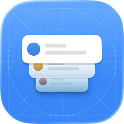
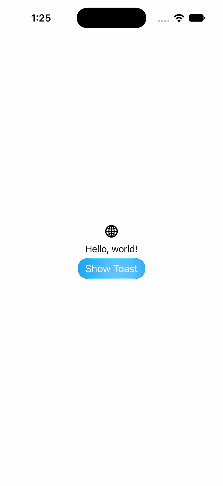
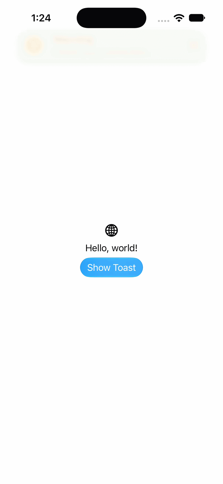
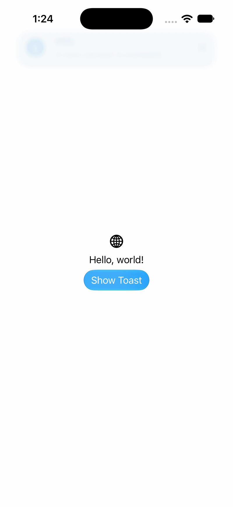

<p align="center">
  
</p>

<h1 align="center">ToastStack</h1>

---

ToastStack is a SwiftUI package for presenting lightweight, stackable toast messages in iOS and macOS apps. It includes success, error, warning, and info styles, plus an option to show your own SwiftUI content.

## Built-in styles

<table>
  <tr>
    <td align="center"><strong>Success</strong><br></td>
    <td align="center"><strong>Error</strong><br></td>
  </tr>
  <tr>
    <td align="center"><strong>Warning</strong><br></td>
    <td align="center"><strong>Info</strong><br></td>
  </tr>
</table>

## Features

- SwiftUI view modifier for hosting toasts
- Built-in success, error, warning, and info styles
- Actionable toasts with a configurable button and handler
- Custom SwiftUI toast content
- Configurable automatic dismissal time (five seconds by default for standard toasts and 60 seconds for actionable toasts); built-in toasts can also be dismissed with the close button
- Layouts that adapt to iPhone, iPad, and macOS
- Colors that adapt to light and dark appearance
- Configurable toast placement and animation

## API documentation

The [DocC catalog](ToastStack/Sources/ToastStack/ToastStack.docc/Documentation.md) includes setup, placement, built-in style, actionable toast, and custom content guides, along with API reference comments.

## Requirements

- Swift 6.4 or later
- iOS 26 or later
- macOS 26 or later

## Installation

In Xcode, choose **File > Add Package Dependencies…** and enter:

```text
https://github.com/elyangutierrez/ToastStack.git
```

Select a release or branch, then add the `ToastStack` library product to your app target. Import the package in files that use it:

```swift
import ToastStack
```

For a Swift package, add the dependency and product to your manifest. This example tracks the `main` branch; switch to a version-based requirement when using a tagged release.

```swift
dependencies: [
    .package(
        url: "https://github.com/elyangutierrez/ToastStack.git",
        branch: "main"
    ),
],
targets: [
    .target(
        name: "YourApp",
        dependencies: [
            .product(name: "ToastStack", package: "ToastStack"),
        ]
    ),
]
```

## Quick start

Attach `.toastHost()` to your app's entry point, then call a `ToastStack` method from an action:

```swift
import SwiftUI
import ToastStack

@main
struct YourApp: App {
    var body: some Scene {
        WindowGroup {
            ContentView()
                .toastHost(toastPlacement: .topTrailing, animationStyle: .snappy)
        }
    }
}
```

The host defaults to `.top` placement and `.spring` animation; configure them with `.toastHost(toastPlacement:animationStyle:)`. The built-in styles are:

```swift
ToastStack.success(message: "Changes saved.")
ToastStack.error(message: "Could not save changes.")
ToastStack.warning(message: "Check your connection.")
ToastStack.info(message: "A new version is available.")
```

Each toast method accepts `dismissalTime` in seconds. It defaults to `5`, so existing calls keep the five-second dismissal time. Pass a different value to customize it:

```swift
ToastStack.success(message: "Changes saved.", dismissalTime: 3)
```

## Placement

The toast method's optional alignment controls its transition edge. `.top`, `.bottom`, `.leading`, and `.trailing` select the matching edge; other alignments use the top edge. `toastPlacement` controls where the stack appears. Use the same edge alignment for both when you want the toast to enter from where the stack is displayed.

```swift
struct UploadView: View {
    var body: some View {
        VStack {
            Button("Upload") {
                ToastStack.success(message: "Upload complete.", .bottom)
            }
        }
        .toastHost(toastPlacement: .bottom)
    }
}
```

## Custom toast content

Pass an `AnyView` to `ToastStack.custom` to display your own SwiftUI view:

```swift
struct UploadToast: View {
    var body: some View {
        Label("Upload complete", systemImage: "checkmark.circle.fill")
            .padding()
            .background(.regularMaterial, in: .capsule)
    }
}

// In a button action:
ToastStack.custom(.bottom, content: AnyView(UploadToast()), dismissalTime: 8)
```

Custom content uses the same configurable `dismissalTime` parameter, with a five-second default. Unlike the built-in toast styles, it does not include a close button.

## Actionable toasts

Use `ToastStack.actionable` with a `ToastAction` to attach a button and handler to a toast. For example, an undo action can restore a draft after it is deleted:

```swift
ToastStack.actionable(
    "The draft was deleted.",
    .top,
    action: ToastAction(
        toastIcon: "trash",
        toastTitle: "Draft deleted",
        buttonTitle: "Undo",
        dismissOnTrigger: true,
        handler: {
            restoreDraft()
        }
    ),
    dismissalTimeDeadline: 15
)
```

`toastIcon` and `buttonImage` accept optional SF Symbol names. The button shows `buttonImage` when set and displays `buttonTitle` otherwise. Tapping the button runs `handler`; when `dismissOnTrigger` is `true`, the toast closes after briefly showing a checkmark. Set it to `false` to keep the toast visible until its automatic dismissal deadline. Actionable toasts default to 60 seconds. See the [Actionable Toasts DocC guide](ToastStack/Sources/ToastStack/ToastStack.docc/ActionableToasts.md) for a complete SwiftUI example.

## Example app

The repository includes a small SwiftUI example app in [`ToastStack/ToastExample`](ToastStack/ToastExample).

## Contributing

Bug reports and pull requests are welcome. For bug reports, include the affected platform and OS version, steps to reproduce, and what you expected to happen. For visual issues, a screenshot or short recording is helpful.

## License

ToastStack is available under the [MIT License](LICENSE).
